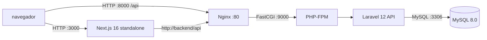

# Nova: e-commerce con Docker

## Descripción

Monorepo de una tienda en español: una aplicación Next.js 16 con App Router sirve la experiencia web y una API REST Laravel 12 gestiona productos, autenticación, pedidos y pagos. Docker Compose coordina frontend, backend y MySQL 8.0 para ejecutar el conjunto con configuración de producción.

## Estructura del repositorio

```text
.
├── .github/workflows/docker-build.yml
├── backend/
│   ├── app/                    # Controladores, modelos y solicitudes Laravel
│   ├── database/migrations/    # Esquema de usuarios, catálogo, pedidos y pagos
│   ├── docker/                 # Nginx, Supervisor, PHP y entrypoint
│   ├── public/                 # Punto de entrada HTTP de Laravel
│   ├── routes/api.php          # API REST bajo /api
│   ├── composer.json
│   └── Dockerfile
├── frontend/
│   ├── app/                    # App Router, páginas y acciones de servidor
│   ├── components/             # Componentes de tienda
│   ├── lib/                    # Tipos, formato y acceso al catálogo
│   ├── package.json
│   ├── next.config.ts
│   └── Dockerfile
├── mysql/
│   ├── conf.d/charset.cnf      # Valores predeterminados utf8mb4
│   └── Dockerfile              # Extiende la imagen oficial MySQL 8.0
├── docker-compose.yml
└── .env.example
```

Los tres servicios (`frontend`, `backend` y `mysql`) tienen un Dockerfile propio. Compose construye las imágenes y las conecta a la red interna del proyecto.

## Arquitectura

Los tres servicios se comunican por la red bridge `ecommerce-network`. Next.js usa `API_URL=http://backend/api` para las peticiones desde el servidor. Nginx recibe el tráfico HTTP del backend y entrega las solicitudes PHP a PHP-FPM; Laravel usa MySQL mediante el nombre de servicio `mysql`.



### Imágenes y caché de capas

El frontend separa las etapas `deps`, `builder` y `runner`. Primero copia solo `package.json` y `package-lock.json` y ejecuta `npm ci`, de modo que los cambios de código no invalidan la capa de dependencias. El builder ejecuta `npm run build` con `output: "standalone"`; el runner copia únicamente `.next/standalone`, `.next/static` y `public`, y arranca `node server.js`.

El backend separa dependencias Composer y runtime PHP. Composer copia primero `composer.json` y `composer.lock` y ejecuta la instalación de producción; luego incorpora la aplicación y genera el autoloader optimizado. La imagen runtime solo contiene PHP-FPM, las extensiones necesarias, Nginx, Supervisor, la aplicación y `vendor`. Los manifiestos cambian con menos frecuencia que el código, por lo que quedan en capas reutilizables.

La imagen personalizada de MySQL extiende `mysql:8.0` y copia `mysql/conf.d/charset.cnf` para establecer `utf8mb4` y `utf8mb4_unicode_ci` como valores predeterminados del servidor y del cliente. Mantiene intactos el entrypoint y el comando oficiales; Compose proporciona las credenciales mediante variables de entorno. No hay `init.sql`: las migraciones de Laravel crean y mantienen el esquema de la aplicación.

Laravel ejecuta `migrate --force`, `config:cache` y `view:cache` al iniciar. No se ejecuta `route:cache`: `backend/routes/web.php` define la ruta `/` con una closure, que Laravel no puede serializar para esa caché. La API en `backend/routes/api.php` sí usa controladores.

### Decisiones de seguridad

- El proceso de Next.js corre como usuario no root.
- No se copian archivos `.env` al contexto de las imágenes y no se incrustan secretos en ellas.
- MySQL no publica el puerto 3306 en el host; solo es accesible en la red de Compose.
- Composer instala dependencias de producción con `--no-dev`.
- Las imágenes de aplicación usan Alpine y extensiones PHP limitadas a las necesarias para esta API.
- Nginx y PHP-FPM ejecutan sus workers como `nginx` y `www-data`; Supervisor permanece como root para abrir el puerto 80 y administrar ambos procesos.
- Los tres servicios tienen healthchecks; Laravel solo arranca después de que MySQL esté `healthy`.
- Los valores de `.env.example` son marcadores para desarrollo, no credenciales apropiadas para producción. Cámbialos antes de desplegar.

## Requisitos

- Docker Engine o Docker Desktop con soporte para Docker Compose v2.
- Git para clonar el repositorio.
- Puertos locales 3000 y 8000 disponibles.

Node.js, PHP y Composer no son necesarios en la máquina para ejecutar el stack. Se usan dentro de las imágenes. Para ejecutar las validaciones locales del código sí se necesitan las herramientas correspondientes.

## Inicio

Desde la raíz del repositorio:

1. Copia la plantilla y revisa sus valores:

	```powershell
	Copy-Item .env.example .env
	```

2. Genera un `APP_KEY` de Laravel y colócalo en `.env`. Con PHP instalado localmente, desde `backend/` ejecuta `php artisan key:generate --show` y copia el valor completo. También puedes dejarlo vacío: el entrypoint genera uno la primera vez. En producción es preferible proporcionar una clave persistente por un gestor de secretos.

3. Cambia `DB_PASSWORD` y `MYSQL_ROOT_PASSWORD` por valores seguros. Para pagos reales, proporciona también `STRIPE_KEY` y `STRIPE_SECRET` desde un almacén de secretos.

4. Construye y arranca:

	```powershell
	docker compose build
	docker compose up -d
	```

Compose espera el estado `healthy` de MySQL antes de iniciar Laravel. El entrypoint realiza además una comprobación de conexión antes de migrar; esto cubre el breve intervalo entre el healthcheck y la disponibilidad de consultas.

## URLs

- Tienda: http://localhost:3000
- Backend Laravel: http://localhost:8000
- Catálogo de productos: http://localhost:8000/api/products
- Healthcheck del backend: http://localhost:8000/up

El navegador utiliza las URLs locales públicas. Las peticiones del servidor Next.js al backend dentro de Docker usan `http://backend/api`.

## Comandos útiles

```powershell
# Estado y healthchecks
docker compose ps

# Logs de todos los servicios o de uno
docker compose logs -f
docker compose logs -f backend

# Ejecutar migraciones manualmente
docker compose exec backend php artisan migrate --force

# Reconstruir después de cambios de código o dependencias
docker compose build --no-cache
docker compose up -d

# Detener y conservar los datos de MySQL
docker compose down

# Eliminar también los datos persistentes de MySQL (irreversible)
docker compose down -v
```

## Solución de problemas

- **Laravel no arranca:** revisa `docker compose logs backend`. Comprueba que `APP_KEY` tenga un valor válido, que las credenciales `DB_*` coincidan con `MYSQL_*` y que MySQL aparezca como `healthy` en `docker compose ps`.
- **MySQL queda en `unhealthy`:** revisa `docker compose logs mysql`; confirma que `MYSQL_ROOT_PASSWORD` no esté vacío. Si modificaste las credenciales después de inicializar el volumen, MySQL conserva las credenciales originales: actualízalas en la base existente o elimina los datos únicamente si puedes perderlos con `docker compose down -v`.
- **El catálogo no muestra datos:** consulta `http://localhost:8000/api/products` y los logs del backend. La migración crea las tablas; no se cargan datos de demostración automáticamente. Para poblar el catálogo ejecuta `docker compose exec backend php artisan db:seed`.
- **El frontend no está saludable:** espera la compilación inicial y revisa `docker compose logs frontend`. Verifica que el puerto 3000 esté disponible y que `API_URL` tenga `http://backend/api` dentro de Docker.
- **Puertos ocupados:** libera el puerto local 3000 o 8000 antes de iniciar los servicios, o modifica el lado izquierdo de la asignación de puertos en `docker-compose.yml`.
- **La autenticación no persiste en HTTP local:** la aplicación marca la cookie de autenticación como `secure` cuando `NODE_ENV=production`. Para producción sirve la tienda por HTTPS; no elimines ese atributo en un despliegue público.

## CI de Docker

El workflow `.github/workflows/docker-build.yml` valida Compose, construye las imágenes, levanta el stack, espera healthchecks y prueba la tienda y `/api/products`. Crea valores efímeros solo para pruebas y ejecuta `docker compose down -v` al finalizar. Es la validación de Docker; las compilaciones locales de Docker no se han ejecutado en este entorno.